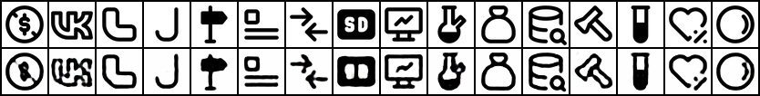
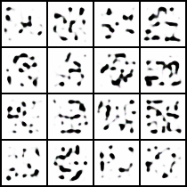
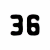

# Icon Autoencoder

Свёрточный автоэнкодер, обученный на ~4 800 иконках [Tabler Icons](https://github.com/tabler/tabler-icons).
Модель сжимает иконку 50×50 в латентный вектор размерности 128 и восстанавливает её обратно;
декодер затем используется для генерации из случайного `z` и интерполяции между иконками.

## Результаты

Итоговый val loss (L1): **0.028** после 30 эпох.

### Реконструкции

Верхний ряд — оригиналы из валидации, нижний — реконструкции.



### Генерация из случайного z

Декодирование `z ~ N(0, I)`. Обычный (не вариационный) автоэнкодер не приучен к такому
распределению латентов, поэтому вместо цельных иконок получаются отдельные штрихи и пятна.



### Интерполяция

Линейная интерполяция между латентами двух тестовых иконок:
`z = (1 − t) · z_A + t · z_B`, 30 кадров.




## Датасет

Скрипт [`src/collecting/scripts/prepare_dataset.py`](src/collecting/scripts/prepare_dataset.py):

1. клонирует репозиторий `tabler/tabler-icons`;
2. рендерит каждый SVG в PNG через `cairosvg` (в 2× разрешении, затем уменьшение LANCZOS до 50×50);
3. заливает прозрачный фон белым и центрирует иконку;
4. отбрасывает почти пустые изображения (> 95 % белых пикселей);
5. удаляет дубликаты по perceptual hash (`imagehash.average_hash`);
6. делит на train / val / test = 80 / 10 / 10 (seed 42).

Итого 4 792 иконки: 3 833 train, 479 val, 480 test.
Списки файлов разбиения лежат в [`src/collecting/splits/`](src/collecting/splits/),
сами картинки в репозиторий не входят.

## Архитектура

[`src/model_ae.py`](src/model_ae.py), `latent_dim = 128`.

**Энкодер:** четыре свёртки `4×4, stride 2` с BatchNorm и ReLU
(3 → 32 → 64 → 128 → 128 каналов, 50 → 25 → 12 → 6 → 3 пикселей),
затем `Flatten` и `Linear(128·3·3 → 128)`.

**Декодер:** зеркально — `Linear(128 → 128·3·3)`, четыре `ConvTranspose2d 4×4, stride 2`
(128 → 128 → 64 → 32 → 3 канала, до 48×48), bilinear upsample до 50×50 и sigmoid.

Обучение: L1 loss, Adam (lr 1e-3), batch 128, до 30 эпох, early stopping с patience 5,
сохраняется лучшая по val loss модель.

## Структура

```
icon-autoencoder/
├── notebook.ipynb              # обучение и визуализация результатов
├── images/                     # картинки для README
└── src/
    ├── model_ae.py             # энкодер, декодер, автоэнкодер
    ├── data_icons.py           # Dataset и DataLoader'ы
    ├── train_ae.py             # обучение, генерация, интерполяция
    ├── utils_vis.py            # сетки реконструкций, GIF, TensorBoard
    └── collecting/
        ├── scripts/            # подготовка и проверка датасета
        └── splits/             # train.txt / val.txt / test.txt
```

## Запуск

Все команды выполняются из папки `icon-autoencoder/`.

```bash
python -m venv venv
source venv/bin/activate
pip install -r requirements.txt
```

`cairosvg` нужна системная библиотека Cairo (на macOS: `brew install cairo`).

1. Подготовить датасет (`src/collecting/data_processed/images/`, нужен `git`):

   ```bash
   python src/collecting/scripts/prepare_dataset.py
   ```

   Проверить, что данные читаются:

   ```bash
   python src/collecting/scripts/load_dataset.py
   ```

2. Обучить модель. Веса (`best.pt`, `last.pt`), реконструкции, случайные сэмплы
   и интерполяция сохраняются в `artifacts/`:

   ```bash
   python src/train_ae.py
   ```

   Основные параметры: `--epochs`, `--latent_dim`, `--loss {l1,mse}`, `--batch_size`, `--lr`
   (полный список — `python src/train_ae.py --help`).

3. Кривые обучения:

   ```bash
   tensorboard --logdir artifacts/tb_runs
   ```

Просмотр результатов — в [`notebook.ipynb`](notebook.ipynb).
