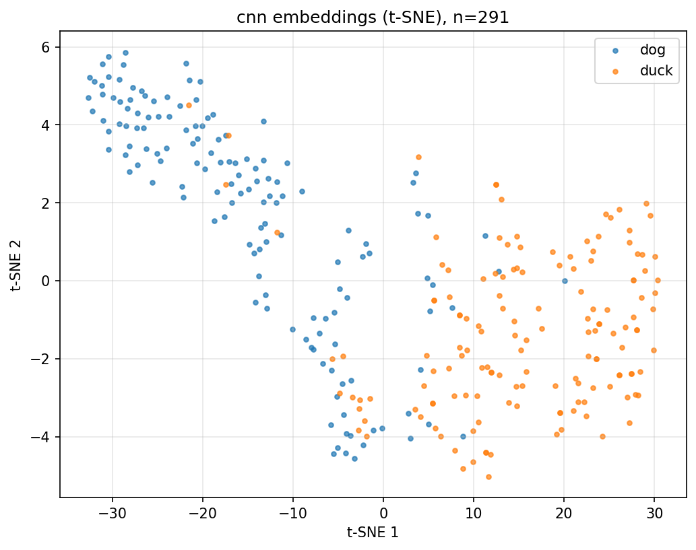
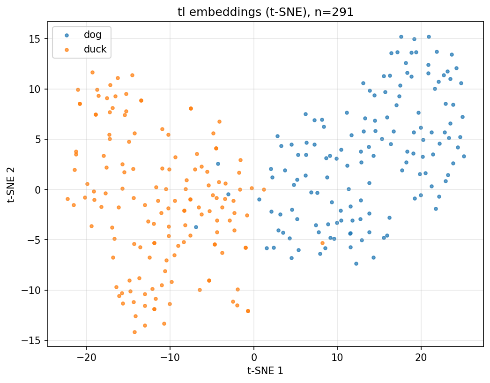

# Image Classification: собаки vs утки

Бинарная классификация изображений (собака / утка) на собственном датасете.
Сравниваются CNN, обученная с нуля, и transfer learning на ResNet18.

## Результаты

Метрики на тестовой выборке (лучшая модель выбирается по F1 на валидации):

| Модель | Accuracy | F1 |
|---|---|---|
| CNN с нуля | 0.89 | 0.90 |
| ResNet18 (transfer learning) | **0.98** | **0.98** |

Предобученный на ImageNet backbone даёт заметный прирост даже при замороженных весах:
на ~2 900 изображениях маленькая CNN не успевает выучить такие же устойчивые признаки.

### Эмбеддинги (t-SNE)

Эмбеддинги тестовой выборки из предпоследнего слоя, спроецированные в 2D через t-SNE.
У ResNet18 классы разделяются почти без пересечений, у CNN в середине остаётся зона, где собаки и утки смешиваются.

| CNN | ResNet18 |
|---|---|
|  |  |

## Датасет

~2 900 изображений (1 472 собаки + 1 472 утки), собраны скриптом
[`src/collecting/download_dataset.py`](src/collecting/download_dataset.py) из двух открытых API:

- собаки: [dog.ceo](https://dog.ceo/dog-api/) — случайные фото пачками по 50 URL;
- утки: [random-d.uk](https://random-d.uk/) — случайное фото на каждый запрос.

Особенности загрузчика:

- **параллельная загрузка** через `ThreadPoolExecutor` (6 потоков);
- **ретраи с экспоненциальным backoff** (1, 2, 4, 8, 16 с) на ошибки 5xx и сетевые сбои,
  для 429 учитывается заголовок `Retry-After`;
- **валидация**: проверка `Content-Type`, минимальный размер файла (10 КБ),
  изображение должно открываться и конвертироваться в RGB через Pillow;
- **атомарная запись**: файл сначала пишется во временный `.tmp`, затем переименовывается,
  поэтому прерванная загрузка не оставляет битых файлов; повторный запуск докачивает недостающее;
- имена собак — SHA-1 от URL, что исключает дубликаты.

Разбиение [`src/collecting/split.py`](src/collecting/split.py): стратифицированное 80 / 10 / 10, seed 42.

## Модели

Обе модели выдают один логит, обучаются с `BCEWithLogitsLoss` и Adam
(lr 1e-3, weight decay 1e-4), 30 эпох, вход 96×96, аугментация — горизонтальный flip.
Гиперпараметры — в [`src/config.py`](src/config.py).

- **CNN** ([`src/cnn/model_cnn.py`](src/cnn/model_cnn.py)): три блока
  `(Conv3×3 → BN → ReLU) × 2 → MaxPool` с каналами 16 / 32 / 64,
  global average pooling, эмбеддинг 64, dropout 0.3.
- **ResNet18** ([`src/tl/model_tl.py`](src/tl/model_tl.py)): backbone с весами ImageNet заморожен,
  обучается только голова `512 → 64 (эмбеддинг) → 128 → 1` с dropout 0.3.

## Структура

```
image-classification/
├── notebook.ipynb            # запуск обучения и визуализация результатов
├── images/                   # картинки для README
└── src/
    ├── config.py             # гиперпараметры
    ├── data.py               # Dataset, трансформации, DataLoader'ы
    ├── train.py              # цикл обучения, метрики, тест
    ├── embed.py              # извлечение эмбеддингов и t-SNE
    ├── cnn/                  # CNN с нуля
    ├── tl/                   # ResNet18 transfer learning
    └── collecting/           # загрузка датасета и разбиение
```

## Запуск

Все команды выполняются из папки `image-classification/`.

```bash
python -m venv venv
source venv/bin/activate
pip install -r requirements.txt
```

1. Скачать датасет (появится `data/images/` и `data/labels.csv`):

   ```bash
   python -m src.collecting.download_dataset
   ```

2. Разбить на train / val / test (`data/splits/*.csv`):

   ```bash
   python -m src.collecting.split
   ```

3. Обучить модели. Веса, эмбеддинги и t-SNE-графики сохраняются в `artifacts/`:

   ```bash
   python -m src.cnn.run_cnn
   python -m src.tl.run_tl
   ```

4. Кривые обучения:

   ```bash
   tensorboard --logdir artifacts/tb
   ```

Тот же сценарий с выводом графиков — в [`notebook.ipynb`](notebook.ipynb).
